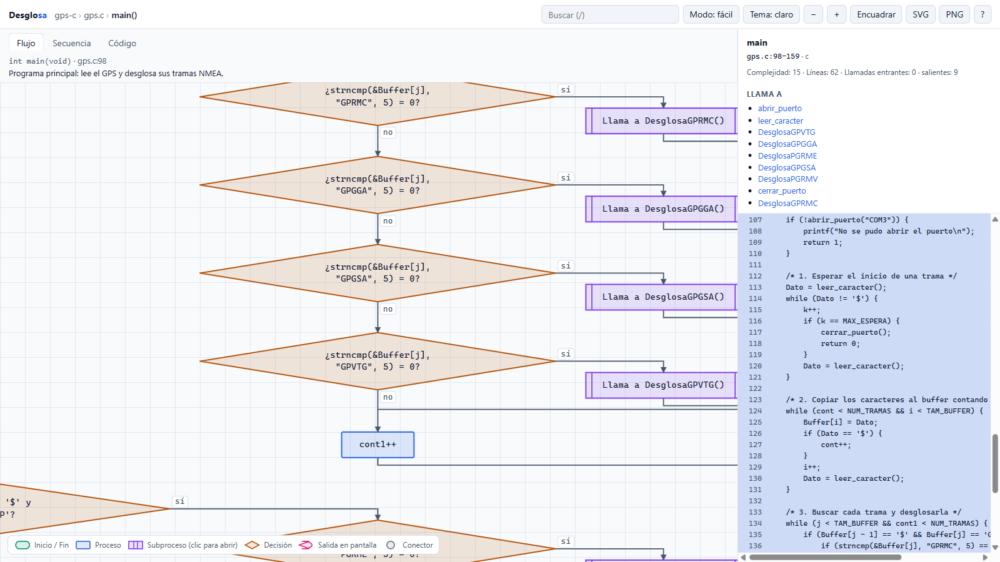
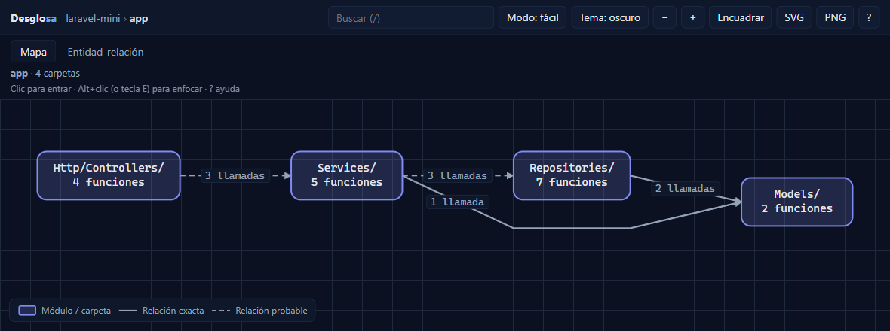
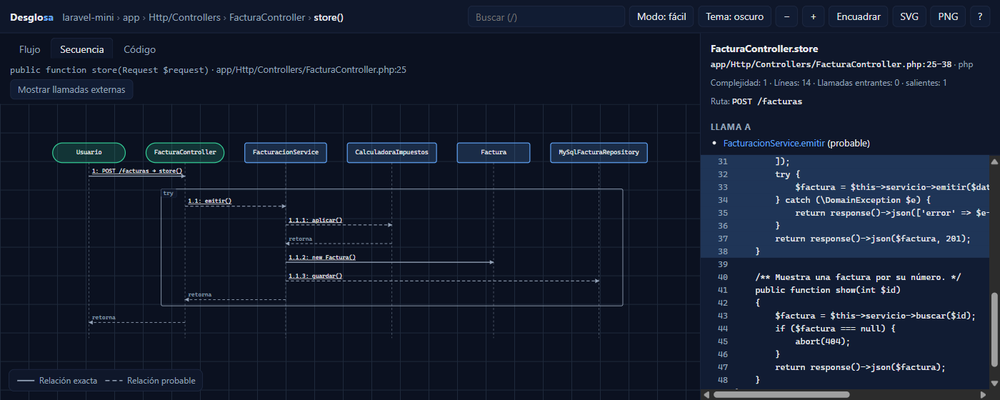
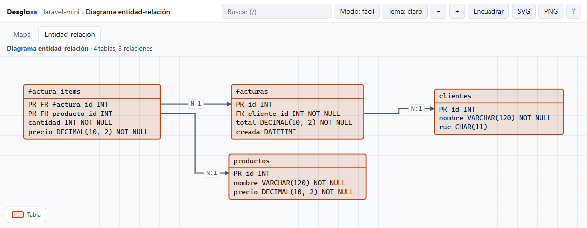
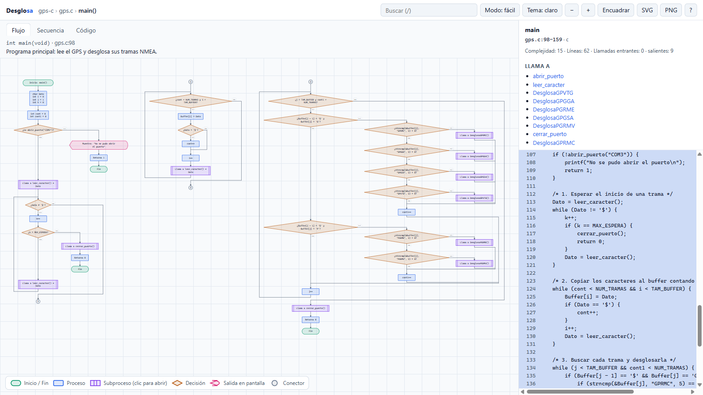

# Desglosa

**Convierte tu código en un mapa interactivo, con diagramas de flujo, de secuencia y
entidad-relación. Sin IA y sin internet.**

[](https://github.com/ItaloReyesCordero/PROYECTO-PARA-LA-FERIA-DE-ING-1/actions/workflows/ci.yml)



Le das una carpeta con código y Desglosa genera **un solo archivo `.html`** que se abre
con doble clic, sin servidor y sin conexión. Dentro puedes ir del panorama general al
detalle:

1. **Mapa por niveles**: carpetas → archivos y clases → funciones, con flechas que dicen
   quién llama a quién (y cuántas veces).
2. **Diagrama de flujo** de cada función, con los símbolos clásicos (inicio/fin,
   proceso, decisión, entrada/salida, subproceso). Haz clic en un subproceso y se abre el
   flujo de esa función.
3. **Diagrama de secuencia** (UML) desde cualquier función: quién llama a quién y en qué
   orden, con bucles, condiciones y `try/catch`.
4. **Diagrama entidad-relación** de los archivos `.sql`, y qué funciones leen o escriben
   cada tabla.

Todo sale de **análisis estático**: Desglosa lee el código con
[tree-sitter](https://tree-sitter.github.io/), nunca lo ejecuta.

## Capturas

| Mapa (tema oscuro) | Secuencia de `FacturaController.store()` |
|---|---|
|  |  |

| Diagrama entidad-relación | Flujo completo de `main()` en columnas |
|---|---|
|  |  |

## Instalación

Necesitas [uv](https://docs.astral.sh/uv/) (en Windows: `winget install astral-sh.uv`).
uv descarga Python si hace falta.

**Opción 1: instalar el comando `desglosa`** (recomendado):

```powershell
uv tool install git+https://github.com/ItaloReyesCordero/PROYECTO-PARA-LA-FERIA-DE-ING-1
desglosa setup                      # descarga las gramáticas UNA vez (único paso con internet)
desglosa analyze C:\ruta\a\tu\proyecto -o mapa.html
```

**Opción 2: usarlo sin instalar nada**, directo desde GitHub:

```powershell
uvx --from git+https://github.com/ItaloReyesCordero/PROYECTO-PARA-LA-FERIA-DE-ING-1 desglosa setup
uvx --from git+https://github.com/ItaloReyesCordero/PROYECTO-PARA-LA-FERIA-DE-ING-1 desglosa analyze . -o mapa.html
```

**Opción 3: para desarrollar** (clonar el repositorio):

```powershell
git clone https://github.com/ItaloReyesCordero/PROYECTO-PARA-LA-FERIA-DE-ING-1.git desglosa
cd desglosa
uv sync
uv run desglosa setup
uv run desglosa doctor    # debe mostrar las 13 gramáticas en OK
```

Funciona en Windows, Linux y macOS (el CI prueba Windows y Linux con Python 3.12 y 3.13).

## Uso

```powershell
# Todo el proyecto: mapa → flujos → secuencias → ER, más un reporte en Markdown
uv run desglosa analyze examples/laravel-mini -o demo.html --report reporte.md

# El diagrama de flujo de una sola función
uv run desglosa flow examples/gps-c gps.c:main -o gps.html

# Diagrama de secuencia desde un punto de entrada
uv run desglosa sequence examples/laravel-mini --entry FacturaController.store -o secuencia.html

# Solo el diagrama entidad-relación
uv run desglosa sql examples/laravel-mini -o er.html
```

| Comando | Qué hace |
|---|---|
| `setup` | descarga las gramáticas (la única vez que se usa internet) |
| `doctor` | muestra versiones y qué gramáticas están disponibles |
| `analyze <ruta>` | genera el HTML completo; `--report archivo.md` añade el reporte |
| `flow <ruta> <archivo>:<función>` | el flujo de una función |
| `sequence <ruta> --entry Clase.metodo` | la secuencia desde una función (`--depth`, 4 por defecto) |
| `sql <ruta>` | el diagrama entidad-relación (`--dialect mysql\|postgres\|sqlite\|tsql`) |
| `explain <ruta> <nombre>` | todo sobre una función o clase: dónde está, quién la llama, a quién llama, complejidad |
| `path <ruta> <desde> <hasta>` | el camino de llamadas más corto entre dos funciones |
| `buscar <ruta> "texto"` | busca funciones y clases por palabras (nombre, descripción, archivo) |
| `export-ir <ruta>` | el modelo intermedio en JSON (ver [docs/IR.md](docs/IR.md)) |
| `debug-ast <archivo>` | imprime el árbol sintáctico (para agregar lenguajes) |

Opciones comunes: `--lang php,python` (solo esos lenguajes), `--ignore PATRON`
(repetible), `--no-source` (no incluir el código en el HTML), `--jobs N` (procesos en
paralelo), `--h-as cpp` (tratar `.h` como C++), `--no-cache` (analizar todo desde cero),
`--cache-dir CARPETA` (dónde guardar la caché).

**Caché:** la segunda vez que analizas un proyecto, solo se vuelven a procesar los
archivos que cambiaron. Se guarda en la carpeta de caché del usuario
(`%LOCALAPPDATA%\desglosa` en Windows), en JSON; nunca dentro de tu proyecto. Si Desglosa
se actualiza, la caché vieja deja de usarse sola.

Desglosa respeta `.gitignore`, `.desglosaignore` y salta `vendor/`, `node_modules/`,
archivos minificados, binarios y archivos de más de 1 MB.

### Preguntarle al código (sin IA)

```powershell
desglosa explain . FacturacionService.emitir     # ¿qué es, quién la usa, qué usa?
desglosa path . FacturaController.store MySqlFacturaRepository.guardar
desglosa buscar . "calcular impuestos"
```

```
Camino más corto (2 pasos):
  FacturaController.store
    --llama [probable]--> FacturacionService.emitir
    --llama [probable]--> MySqlFacturaRepository.guardar
```

Con `--json` la respuesta sale en JSON, para scripts o para un asistente de IA. Si un
nombre corresponde a varias funciones, Desglosa no elige: las lista y sale con código
`3`; usa `archivo:Nombre` para precisar. En un proyecto normal cada consulta tarda 1–2 s;
en uno de medio millón de líneas (Django), ~17 s con la caché llena.

Códigos de salida: `0` bien, `1` error de uso, `2` faltan gramáticas (ejecuta `setup`),
`3` nombre ambiguo, `4` no encontrado.

## Cómo se usa el visor

- **Clic** en un elemento del mapa para entrar; las **migas** de arriba sirven para volver.
- **Alt+clic** (o la tecla `E`) **enfoca** un elemento: resalta lo que usa y lo que lo usa.
- En un flujo, el **clic en un subproceso** (rectángulo con doble línea) abre esa función.
- **Modo fácil / técnico** (`M`): textos en español ("¿total > 0?", "Para cada item en
  items") o el código literal.
- `/` buscar · `Esc` subir · `+` `−` `0` zoom · `F` encuadrar · `T` tema · `?` ayuda.
- Panel lateral con el código fuente, las líneas del nodo seleccionado resaltadas, las
  llamadas entrantes y salientes, la complejidad y, si existen, la ruta HTTP y las tablas.
- Botones **SVG** y **PNG** para exportar la vista; también se puede imprimir.

Las líneas sólidas son relaciones seguras; las punteadas, probables o ambiguas; las grises,
llamadas fuera del proyecto. Así nunca se presenta una suposición como un hecho.

## Ejemplos incluidos

| Carpeta | Qué muestra | HTML ya generado |
|---|---|---|
| [`examples/gps-c/`](examples/gps-c/) | lectura de un GPS por puerto serie en C: bucles, decisiones, tramas NMEA; el flujo se parte en columnas con conectores | [`desglosa.html`](examples/gps-c/desglosa.html) |
| [`examples/laravel-mini/`](examples/laravel-mini/) | un mini sistema de facturación en Laravel: rutas, controlador, servicio, interfaz de repositorio con implementación MySQL y esquema SQL | [`desglosa.html`](examples/laravel-mini/desglosa.html) · [`reporte.md`](examples/laravel-mini/reporte.md) |

Descarga el `.html` y ábrelo con doble clic.

## Lenguajes

| Lenguaje | Mapa y llamadas | Diagrama de flujo | Nivel |
|---|---|---|---|
| Python | ✔ | ✔ | completo |
| JavaScript | ✔ | ✔ | completo |
| TypeScript (y TSX) | ✔ | ✔ | completo |
| PHP (con rutas de Laravel) | ✔ | ✔ | completo |
| Java | ✔ | ✔ | completo |
| C | ✔ | ✔ | completo |
| C++ | ✔ | ✔ | completo |
| Go | ✔ | ✔ | mejor esfuerzo |
| Ruby | ✔ | ✔ | mejor esfuerzo |
| Rust | ✔ | ✔ | mejor esfuerzo |
| Kotlin | ✔ | ✔ | mejor esfuerzo |
| Swift | ✔ | ✔ | mejor esfuerzo |
| SQL | tablas, PK y FK | — | completo |

"Mejor esfuerzo" quiere decir que pasan los mismos tests que los demás, pero sus
construcciones menos comunes (macros, bloques, metaprogramación) se dibujan de forma más
simple. Detalles por lenguaje en [docs/ADDING_A_LANGUAGE.md](docs/ADDING_A_LANGUAGE.md).

## Rendimiento

Probado con proyectos reales de GitHub, en un portátil con Windows 11 y 8 núcleos
(Python 3.14), comando `analyze` completo y sin caché:

| Proyecto | Líneas | Análisis | Total | HTML | Abre en el navegador |
|---|---|---|---|---|---|
| `examples/laravel-mini` | 260 | 0,1 s | 2 s | 0,1 MB | al instante |
| [Spring Petclinic](https://github.com/spring-projects/spring-petclinic) (Java) | 4 300 | 1 s | 3 s | 0,3 MB | al instante |
| [Express](https://github.com/expressjs/express) (JavaScript) | 22 000 | 4 s | 5 s | 0,3 MB | al instante |
| [Laravel](https://github.com/laravel/framework) (PHP) | 581 000 | 32 s | 72 s | 52 MB | 1,4 s |
| [Django](https://github.com/django/django) (Python) | 530 000 | 35 s | 90 s | 69 MB | 1,8 s |

"Análisis" es lo que imprime la consola; "Total" incluye generar el HTML. La SPEC pedía
1 000 archivos en menos de 2 minutos: Laravel tiene 3 030 y Django 2 968.

- **Con caché**, si cambias un archivo de un proyecto de 200 000 líneas, el análisis baja
  de 13 s a unos 6 s.
- **El HTML abre rápido aunque pese mucho:** cada archivo de código va comprimido aparte
  y el navegador descomprime solo lo que abres (una función se abre en ~50 ms, incluso en
  Django). Funciona sin internet, con doble clic.
- Varios procesos solo se usan cuando el código suma 2 MB o más: por debajo, arrancar
  procesos en Windows cuesta más de lo que ahorra (medido). Con `--jobs N` se fuerza.
- En los niveles del mapa muy conectados (en Django, 17 carpetas con 145 relaciones) se
  dibujan solo las relaciones más fuertes, y el visor avisa cuántas se ocultaron.

## Límites

Es análisis estático, con límites que conviene conocer (y explicar):

- La **inyección de dependencias** y las interfaces no dicen qué clase llega en
  ejecución: se muestran las *posibles implementaciones*.
- Las **llamadas dinámicas** (`$obj->$metodo()`, reflexión, callbacks) quedan como
  externas o ambiguas. Nunca se adivina.
- Las **macros y `#ifdef`** no se expanden; los ternarios y lambdas quedan dentro del
  texto del nodo; `goto` no se sigue.
- El **modo fácil reformula, no explica**: traduce la sintaxis a español, no entiende la
  intención del código.
- La relación función → tabla solo ve **SQL escrito en cadenas**, no consultas de un ORM.
- En frameworks grandes muchas llamadas son **ambiguas** (`->with()` existe en 20 clases
  de Laravel). Si una llamada tiene más de 4 destinos posibles, no se cuenta ni se dibuja
  como llamada a ninguno.

Lista completa en [docs/LIMITES.md](docs/LIMITES.md).

## Cómo funciona

```
carpeta → escaneo → árbol sintáctico (tree-sitter) → símbolos y llamadas
        → resolución (exacta / probable / ambigua / externa)
        → diagramas y coordenadas → un solo HTML
```

Un único motor sirve a los 12 lenguajes: cada lenguaje solo describe la forma de su árbol
sintáctico (`LangSpec`) y unos pocos ganchos (`LangHooks`). El resultado es determinista:
el mismo código produce exactamente el mismo HTML.

- [docs/ARCHITECTURE.md](docs/ARCHITECTURE.md): etapas, módulos y decisiones.
- [docs/IR.md](docs/IR.md): el modelo intermedio.
- [docs/DISENO.md](docs/DISENO.md): colores, símbolos y reglas visuales.
- [docs/ADDING_A_LANGUAGE.md](docs/ADDING_A_LANGUAGE.md): cómo agregar un lenguaje.
- [docs/PROGRESO.md](docs/PROGRESO.md): bitácora de las fases del proyecto.

## Desarrollo

```powershell
uv sync
uv run desglosa setup
uv run pytest -q                    # tests
uv run ruff check .                 # estilo
uv run pytest --update-golden       # regenerar salidas esperadas (revisa el diff)
```

Para regenerar los ejemplos:

```powershell
uv run desglosa analyze examples/gps-c -o examples/gps-c/desglosa.html
uv run desglosa analyze examples/laravel-mini -o examples/laravel-mini/desglosa.html --report examples/laravel-mini/reporte.md
```

Seguridad: el código analizado nunca se ejecuta, el visor no usa `innerHTML` con datos del
código y el JSON incrustado escapa `<`, `>`, `&` y los separadores de línea Unicode (hay
un test con `</script><script>alert(1)</script>` dentro de una cadena).

## Licencia y créditos

MIT © 2026 Italo Reyes Cordero. Ver [LICENSE](LICENSE).

Proyecto para la Feria de Ingeniería de la Universidad Continental. Inspirado
conceptualmente en Graphify y Archify, sin código de ninguno de los dos; dependencias y
licencias en [NOTICE.md](NOTICE.md).
