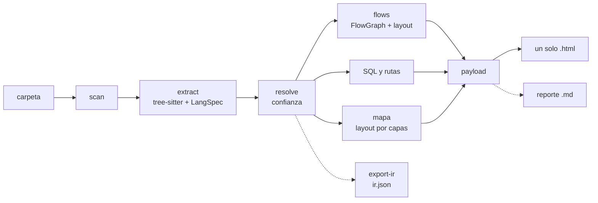
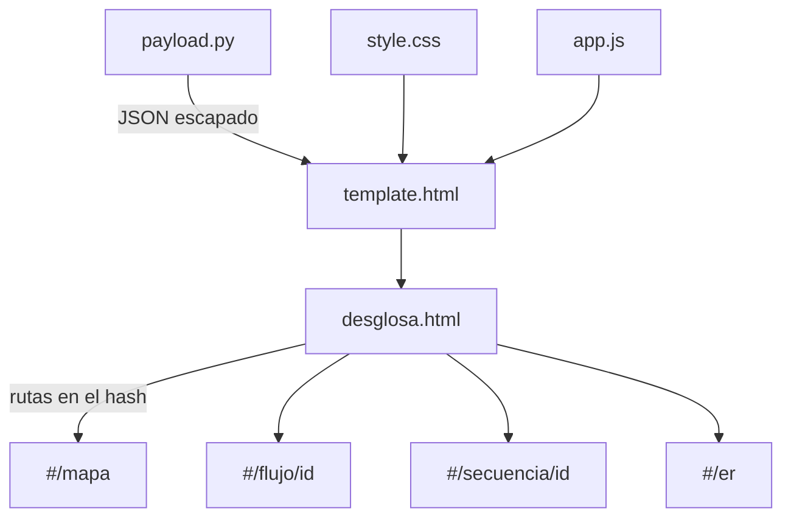

# Arquitectura

Desglosa es un **compilador de diagramas**: lee código, lo convierte en un modelo
intermedio (IR) y de ahí dibuja. No ejecuta el código analizado, no usa IA y no usa la red
(salvo `desglosa setup`, que descarga las gramáticas una sola vez).

## Pipeline



| Etapa | Módulo | Entrada → salida |
|---|---|---|
| Escaneo | `scan.py` | carpeta → lista ordenada de archivos con su lenguaje. Respeta `.gitignore`, `.desglosaignore` y `--ignore`; salta `vendor/`, `node_modules/`, binarios, minificados y archivos enormes. |
| Extracción | `extract.py` + `langs/*.py` | cada archivo → `FileResult` (símbolos, imports, llamadas con su contexto de control, tipos de variables). Corre en varios procesos si el proyecto es grande. |
| Resolución | `resolve.py` | todas las llamadas → a qué definición apuntan y con qué **confianza** (exacta, probable, ambigua, externa). |
| Flujos | `flow.py`, `flows_stage.py`, `layout/flow.py` | cada función → `FlowGraph` (nodos y aristas) → coordenadas. |
| Mapa | `macro.py`, `layout/layered.py` | símbolos + llamadas → niveles (carpetas → archivos/clases → funciones) con aristas agregadas. |
| Secuencia | `sequence.py`, `layout/sequence.py` | una función de entrada → mensajes numerados, fragmentos y participantes. |
| SQL | `sqlmodel.py`, `layout/er.py` | `.sql` → tablas, PK, FK; cadenas SQL del código → qué función lee/escribe cada tabla. |
| Rutas | `routes.py` | `routes/*.php` de Laravel → puntos de entrada. |
| Visor | `render/` | todo lo anterior → JSON incrustado en `template.html` con `app.js` y `style.css`. |
| Reporte | `report.py` | análisis → Markdown con métricas. |

`pipeline.py` orquesta las etapas y `cli.py` expone los comandos.

## Un motor, doce lenguajes

La extracción y el diagrama de flujo son **genéricos**. Cada lenguaje aporta:

- un `LangSpec` (datos): qué nodos del árbol sintáctico son funciones, clases, llamadas,
  `if`, bucles, `switch`, `try`, etc.;
- un `LangHooks` (comportamiento): funciones pequeñas para lo que no se puede describir
  con una tabla (dónde está la condición de un `for`, cómo se llama el receptor de una
  llamada, si un `return` es implícito…).

`flow.py` nunca pregunta "¿esto es PHP?"; le pide a los hooks la forma del nodo. Por eso
agregar un lenguaje es escribir un `LangSpec` + hooks + fixture + test
(ver [ADDING_A_LANGUAGE.md](ADDING_A_LANGUAGE.md)).

## Decisiones que sostienen todo

- **Ids estables**: `sha1("lang|ruta|qualname|línea")[:12]`. El mismo código da los
  mismos ids en cualquier máquina y en cualquier orden de procesos.
- **Determinismo**: todo se ordena antes de serializar, el JSON usa `sort_keys=True` y no
  hay fechas. Un test comprueba que dos ejecuciones producen el mismo SHA-256 del HTML, y
  otro que 1 proceso y N procesos dan el mismo resultado.
- **Sin red en `analyze`**: antes de pedir un parser se comprueba que la gramática ya está
  descargada; si falta, el programa sale con código 2 y pide `desglosa setup`. Un test
  reemplaza `socket.socket` por uno que falla durante el análisis.
- **Seguridad del HTML**: el JSON incrustado escapa `<`, `>`, `&`, `/`, U+2028 y U+2029, y
  el visor solo usa `textContent` y `createElementNS` (nunca `innerHTML` con datos del
  código). Un fixture con `</script><script>alert(1)</script>` lo prueba.
- **Layout en Python, dibujo en el navegador**: las coordenadas se calculan al generar el
  HTML (con tests de no superposición), así el visor es simple y el resultado es el mismo
  en cualquier navegador.
- **Windows primero**: rutas con `pathlib`, salida POSIX relativa, UTF-8 con `\n`, y las
  funciones que corren en otros procesos son de nivel módulo (Windows usa `spawn`).

## Paralelismo

Arrancar un proceso en Windows cuesta unos 0,4 s (importar tree-sitter y cargar
gramáticas). Por eso Desglosa usa **un solo grupo de procesos** para extracción y flujos,
y solo cuando el código suma 2 MB o más (o si se pide con `--jobs N`). Con 1 000
archivos pequeños (0,8 MB) un proceso resultó más rápido que ocho; con 15 MB de código,
ocho procesos ganan. Las mediciones están en la sección "Rendimiento" del README.

Dos etapas crecían más rápido que el proyecto y se corrigieron midiendo con `cProfile`:
el resolvedor recorría todos los archivos por cada import (ahora usa índices calculados
una vez) y cada diagrama de secuencia volvía a indexar todas las llamadas del proyecto
(ahora comparten un `SequenceIndex`).

Las secuencias se calculan en un solo proceso **a propósito**: repartirlas entre 8 fue el
doble de lento en Django, porque enviar el proyecto (58 MB) a cada proceso costaba más
que el cálculo.

## Caché incremental (`cache.py`)

- Clave de la extracción: ruta + lenguaje + hash del contenido + huella del código de
  Desglosa. Clave de los flujos: todo lo que los define (funciones del archivo, cómo se
  resolvió cada llamada, opciones de dibujo y contenido).
- Se guarda en **JSON comprimido, nunca `pickle`**: un archivo de caché manipulado no
  puede ejecutar código, y uno dañado se ignora. Vive en la carpeta de caché del usuario,
  una subcarpeta por proyecto; al terminar se borran las entradas que ya no se usaron.
- La escriben los propios procesos de trabajo (en paralelo) y los flujos se guardan ya
  en el formato del HTML, así que leerlos no exige reconstruir objetos.
- Para leer rápido, cada tipo de dato tiene un decodificador armado una sola vez: leer
  las anotaciones de tipo en cada objeto hacía que la caché fuera más lenta que analizar.

## El HTML por dentro (`render/packs.py`)

```
<script type="application/json" id="desglosa-data">
  { "meta": {…},            ← nombre, versión, vista inicial (legible)
    "index": "eNrt…",        ← símbolos, mapa, llamadas, ER (comprimido)
    "packs": {               ← un paquete comprimido por archivo de código:
      "app/Models/Factura.php": "eNrt…",   flujos + secuencias + código fuente
      … } }
</script>
```

Cada paquete es JSON → zlib (nivel 9) → base64 "url-safe". Al abrir, el visor
descomprime el índice (Django queda listo en 1,8 s) y cada paquete recién cuando se abre
una función de ese archivo (~50 ms), con `DecompressionStream`, que viene en los navegadores
actuales. No usa librerías ni red, y funciona con `file://`.

## Flujo de datos del visor



El estado de la vista vive en el hash de la URL (`#/flujo/<id>?modo=facil&tema=claro`),
así que el botón "atrás" del navegador funciona y un enlace abre exactamente la misma
vista, incluso con `file://`.
